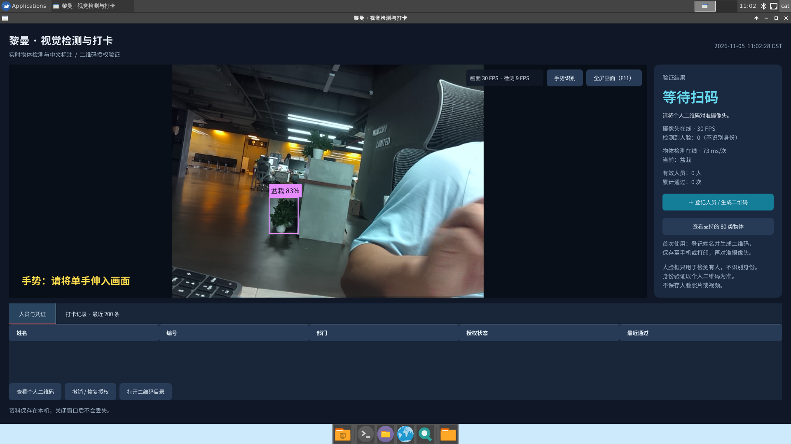
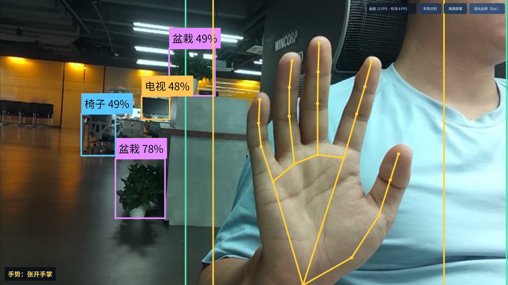
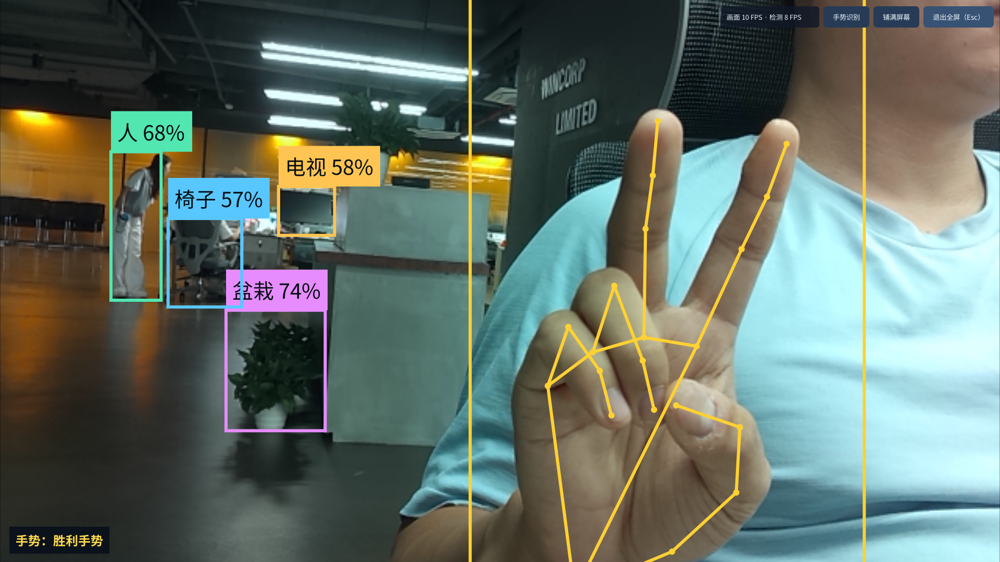

# LubanCat Vision

在 LubanCat-2 / RK3568 上运行的 CSI 摄像头应用：YOLOv5 物体检测、中文标签、二维码登记与打卡、数字与 OK 手势识别，以及六种按需开启的互动模式。

默认通过 **Mali-G52 GPU 流畅档**显示预览，支持开机全屏、数字＋OK 开启互动、遮住镜头复位，以及双手 STOP 退出程序。GPU 不可用时自动回退到标准预览。

## 已部署开发板：启动与关闭

在开发板本机终端或 SSH 中执行：

```bash
sudo systemctl start liman-checkin      # 启动，画面显示在开发板 HDMI 桌面
sudo systemctl restart liman-checkin    # 重启程序
sudo systemctl stop liman-checkin       # 关闭程序
systemctl status liman-checkin          # 查看状态
journalctl -u liman-checkin -n 50 --no-pager
```

使用 `root` 登录时可省略 `sudo`。双手 STOP 正常退出后，使用 `start` 命令重新打开；程序不会立即被服务拉起，下次开机仍会自动启动。首次部署方法见下文。

## 实际运行效果

以下为开发板 HDMI 桌面的**早期版本**实际截屏，尚未展示后续加入的 GPU 状态、数字手势和互动控件；当前操作方式以下文为准。界面概览使用临时空数据库展示，不包含真实姓名、工号或二维码凭证。

### 完整界面与物体检测

摄像头预览、中文物体标签、二维码登记入口及人员与记录面板。



### 张开手掌

实时叠加手部关键点与骨架，左下角显示“手势：张开手掌”；背景物体仍同时进行检测。



### 比耶手势

识别双指比耶姿势，左下角显示“手势：胜利手势”。



## 当前功能

- OV8858 CSI CAM1 预览，640×480 采集，已在 1920×1080 HDMI 桌面验证等比例显示与裁切铺满。F11 / 双击切换全屏，Esc 退出全屏。
- RKNN NPU 执行 YOLOv5s，支持 COCO 80 类物体，中文名称和置信度叠加。
- 单手识别数字 1～5、OK，以及张掌、握拳、比耶、点赞、食指向上；显示关键点、骨架与识别结果。
- 数字＋OK 开启指定互动；遮镜头返回普通 YOLO 模式；双手张掌 STOP 退出整个程序。
- 隔空画画、掌心粒子、捏合缩放、隔空打砖块、物体扫描仪、人体动作游戏，互斥运行、按需开启。
- 登记姓名、工号、部门并生成随机个人二维码，扫码授权、撤销/恢复授权和导出记录。人脸框只检测人脸，不确认身份。
- 预览、物体检测、扫码独立处理最新帧；手势与人体模型使用独立低优先级进程。人体模型仅在人体游戏开启时加载，捏合光流跟踪仅在捏合模式启用时运行。
- GPU 显示进程与 GTK 界面隔离，通过共享内存交换视频与透明叠加层；GPU 完成视频缩放及最终合成。普通模式的标注按内容变化缓存，GPU 故障可回退到标准预览。

## 手势操作

### 数字＋OK：不用鼠标开启互动

在**普通 YOLO 模式**下，保持“手势识别”开启，将单手完整伸入画面：

1. 做出下表数字，保持约 1～2 秒，看到待开启模式的提示。
2. 在 5 秒内改做 **OK**：拇指与食指围成圈，其余三指伸直，再保持约 1 秒。
3. 程序自动切换模式，并打开“互动”开关。

| 数字 | 手指姿势 | 开启模式 |
|---|---|---|
| 1 | 只伸食指 | 隔空画画 |
| 2 | 伸食指、中指，比耶 | 掌心粒子 |
| 3 | 伸食指、中指、无名指；拇指与小指收起 | 捏合缩放 |
| 4 | 拇指收起，其余四指伸直 | 隔空打砖块 |
| 5 | 五指张开 | 物体扫描仪 |

数字＋OK 只在普通模式生效，避免玩法动作触发模式切换。换玩法时，先遮镜头复位，再选择数字＋OK。人体动作游戏通过右上角下拉框手动选择，再开启“互动”；其他模式也可这样手动开启。

### 复位、退出与全屏

| 动作 | 效果 |
|---|---|
| 完全遮住镜头，使画面接近全黑并保持约 2 秒 | 退出互动，恢复普通 YOLO 检测；程序内部要求黑画面持续约 1.2 秒 |
| 双手五指张开，掌心朝向摄像头，两只手完整入画并保持约 2～3 秒 | 显示退出倒计时，随后关闭整个程序；倒计时期间放下任意一只手可取消 |
| 普通模式中，握拳后再张掌，每个姿势保持约 1 秒 | 进入全屏 |
| 普通模式中，张掌后再握拳，每个姿势保持约 1 秒 | 退出全屏 |
| F11 / 双击预览 | 切换全屏 |
| Esc | 退出全屏，继续运行程序 |

双手 STOP 在各模式及关闭普通手势识别后仍可用。因此扫描仪、人体游戏及关闭普通手势识别时，会保留低频双手监测。镜头复位依靠画面亮度，环境整体持续变黑也可能触发；短暂变暗或局部遮挡不会立即复位。

## 六种互动模式

| 模式 | 操作 |
|---|---|
| 隔空画画 | 食指画线，握拳停笔，张掌保持约 1 秒清空，比耶换色；支持短暂丢失后的续笔 |
| 掌心粒子 | 张掌释放粒子，握拳聚拢，比耶换色 |
| 捏合缩放 | 拇指、食指移到卡片附近并捏合，绿色边框表示抓住；移动手拖动，张开两指松开；松开后比耶，通过食指与中指开合缩放 |
| 隔空打砖块 | 张掌开始/继续，左右移动手掌接球，握拳暂停；丢手时自动暂停 |
| 物体扫描仪 | 将物体放入中央框，点击“扫描”或按空格，冻结画面并单次检测；有结果时可保存卡片，点击“重新取景”重拍 |
| 人体动作游戏 | 后退使肩、髋、腿入镜；举双手开始/暂停，左右移身躲红块，下蹲躲紫杆、接金币；可点击“重开/校准” |

互动模式暂停普通的连续物体检测与扫码；扫描仪仅在明确触发扫描时调用检测。退出互动后恢复。人体游戏举手时，也需留意双手张掌持续保持会触发全局 STOP。

## GPU 档位、画质与性能

默认启用 GPU，使用 **30 FPS 目标的流畅档**；另有 20 FPS 目标的低占用档。两档使用同样的摄像头采集分辨率、图像与模型设置：当前采集为 **640×480**，GPU 放大到 HDMI 桌面显示，实际细节受采集分辨率限制。

**预览 FPS 与检测 FPS 分开统计**：预览决定视频的顺滑程度，YOLO 检测决定物体框与名称的更新频率。约 8.3 FPS 的检测意味着每约 120 毫秒更新一次检测结果，即使视频以更高帧率显示，检测频率仍可保持不变。

以下是在同一开发板、1080p 桌面、普通 YOLO 模式下，分两组进行交替短测的平均值。标准预览与 GPU 预览均保留 YOLO、手势及扫码/人脸框的后台计算：

| GPU 档位 | 同轮标准预览 FPS / 整机 CPU | GPU 完整界面 FPS / 整机 CPU |
|---|---|---|
| 低占用，目标 20 FPS | 20.7 / 64.6% | **19.8 / 53.8%** |
| 流畅，目标 30 FPS，默认 | 21.0 / 62.7% | **26.9 / 60.2%** |

两组摄像头采集约 29.9 FPS、YOLO 检测约 8.3 FPS。独立 GPU 原型约 28.3 FPS 的结果只包含视频与检测框，不代表完整界面的性能。上述数据不是固定帧率或端到端延迟保证，互动模式、场景、温度与调频状态都会影响结果。

程序直接使用已安装的 Mali EGL 驱动，系统默认 GLX 显示为 llvmpipe 并不等于本程序的 GPU 路径使用软件渲染。右上角帧率前缀为“GPU”时表示 GPU 路径已启用；回退时显示标准预览状态。文字与互动内容由 Cairo 生成透明层，再交给 GPU 合成。

## 已验证环境

LubanCat-2 v3 / RK3568 / Mali-G52，Debian 10，Linux 4.19.232，Python 3.7.3，OpenCV 3.2，GTK3 / X11 / XFCE；摄像头使用 OV8858、CAM1 和 rkisp-vir1。GPU 已验证 ARM Mali OpenGL ES 3.2 驱动。其他硬件、摄像头、发行版尚未验证。

这是应用源码，不包含系统镜像、内核设备树和摄像头驱动。先确认系统已识别摄像头，rkaiq 3A 正常工作，且桌面能够正常登录。

## 目录

- `app.py`：GTK 界面、预览、全屏与检测叠加。
- `gpu_bridge.py`、`gpu_presenter.py`、`gpu_display.py`：共享内存协议、独立显示进程与 Mali EGL 渲染。
- `gpu_preview.py`：独立 GPU 视频/检测框原型，可选输出性能统计，不包含完整应用的交互界面和打卡流程。
- `core.py`：本机 SQLite、二维码登记和授权逻辑。
- `objects.py`：RKNN YOLOv5 推理与后处理。
- `gesture_client.py`、`gesture_engine.py`：预览侧客户端与独立推理进程。
- `gestures.py`、`gesture_handpose.py`、`gesture_common.py`：双手检测、关键点、数字/OK、模式确认、全屏及 STOP 时序。
- `hand_motion.py`：捏合模式的最新帧光流跟踪。
- `visual_demo.py`、`interaction_games.py`：六种互动模式及其状态管理。
- `body_engine.py`：按需加载的 MoveNet 人体关键点进程。
- `wait_display.py`、`deploy/liman-checkin.service`：等待 X11 就绪并自动启动应用。

## 运行依赖

系统需提供 Python 3、PyGObject/GTK3、GStreamer 及其 Python 绑定、V4L2 和 videoconvert 插件、OpenCV、NumPy、PyCairo、PangoCairo、qrcode、Pillow、libzbar、Noto CJK 字体，以及 OpenCV Haar 人脸和眼睛级联模型。

GPU 路径还需 X11 的 `libX11.so.6`、板卡兼容的 `libmali.so.1` 和 Mali 设备访问权限。使用系统已有的匹配驱动；应用不会替换全局 EGL/GL 库。启动时缺少 GPU 条件或运行中显示进程故障，均回退到标准预览。

手部与人体识别进程使用私有目录 `gesture-runtime/`，已验证版本为 `tflite-runtime==2.11.0` 与 `numpy==1.21.6`，需选用 CPython 3.7 / aarch64 对应构建。不要将电脑上的 x86/Windows 包复制到板子。主程序使用系统 NumPy，私有依赖由手部与人体识别进程载入。

## 模型与 RKNN 运行库

仓库不附带模型权重或二进制运行库。部署时按下表放置，先查看各上游项目的许可证与模型说明。不要用不兼容的新运行库直接替换系统运行库。当前 RKNN 模型对应私有 v1.5.2 运行库。

| 部署路径 | 上游下载 | SHA-256 |
|---|---|---|
| `models/yolov5s-640-640.rknn` | [下载](https://raw.githubusercontent.com/rockchip-linux/rknpu2/v1.5.2/examples/rknn_yolov5_demo/model/RK3566_RK3568/yolov5s-640-640.rknn) | `6ec478fa14fa9ee2067041158a410a61b128242d7bef21e3f16276c47ef38d08` |
| `lib/librknnrt.so` | [下载](https://raw.githubusercontent.com/rockchip-linux/rknpu2/v1.5.2/runtime/RK356X/Linux/librknn_api/aarch64/librknnrt.so) | `135f497b820ae161d36f756c26b949419d271918e915e71663d424e5c1d799e7` |
| `gesture-models/palm_detection_lite.tflite` | [下载](https://storage.googleapis.com/mediapipe-assets/palm_detection_lite.tflite) | `e9a4aaddf90dda56a87235303cf00e4c2d3fb28725f68fd88772997dac905c18` |
| `gesture-models/hand_landmark_lite.tflite` | [下载](https://storage.googleapis.com/mediapipe-assets/hand_landmark_lite.tflite) | `d7fde8ac11f8ce03f8663775bfc323f4fc9f2a38062b4f4efa142874ef5b2a48` |
| `gesture-models/movenet-lightning.tflite` | [Google MoveNet Lightning INT8 v1](https://www.kaggle.com/models/google/movenet/tfLite/singlepose-lightning-tflite-int8/1) | `cd7cc22fa946e5d146a7b98d496853e1923e22828d3972d579973f27f91bb105` |

人体游戏使用上表指定版本；Kaggle 下载包需解压，将其中的模型放到对应路径并核对哈希。此模型输入为 `uint8`、形状 `[1, 192, 192, 3]`。缺少该模型会影响人体游戏，其他模式可独立使用。

## 板端启动

1. 将应用部署至 `/opt/liman-checkin`，按上表放置模型和运行库，并准备 `gesture-runtime/`。
2. 检查 `app.py` 中 `DEVICE`；当前为 `/dev/v4l/by-path/platform-rkisp-vir1-video-index0`。
3. 在本机 X11 桌面用户下运行 `python3 /opt/liman-checkin/app.py`，先确认预览、识别和扫码正常。
4. 自动启动可使用 `deploy/liman-checkin.service`。此配置针对桌面用户 `cat`、`DISPLAY=:0` 和 `/home/cat/.Xauthority`；其他环境需调整，并配置好桌面自动登录与摄像头访问权限。
5. 安装 unit 后执行 `systemctl daemon-reload` 和 `systemctl enable --now liman-checkin.service`；通过 `journalctl -u liman-checkin.service` 查看日志。

### 启动环境变量

| 变量 | 默认值 | 说明 |
|---|---|---|
| `LIMAN_GPU_PREVIEW` | `1` | `1` 启用 GPU，`0` 强制使用标准预览 |
| `LIMAN_GPU_FPS` | `30` | `30` 流畅档；显式设为 `20` 使用低占用档，仅影响 GPU 预览 |
| `LIMAN_CAMERA_FULLSCREEN` | 未设置 | 设为 `1` 开机进入全屏；仓库提供的 service 已设置 |
| `LIMAN_CAMERA_FILL` | 全屏启动时为 `1` | 全屏启动时等比例裁切铺满；设为 `0` 显示完整画面 |

修改 systemd 服务的 GPU 档位，可执行：

```bash
sudo systemctl edit liman-checkin
```

在 override 中设置低占用档：

```ini
[Service]
Environment=LIMAN_GPU_FPS=20
```

保存后执行：

```bash
sudo systemctl daemon-reload
sudo systemctl restart liman-checkin
```

切回默认流畅档时，将 override 中的值改为 `30`。需要强制标准预览时，可在同一 `[Service]` 段设置 `Environment=LIMAN_GPU_PREVIEW=0`。

识别手势时保持光线充足、手部完整入镜。仅关闭“手势识别”会停止普通手势操作；双手 STOP 监测继续保留。

### 独立 GPU 原型

原型与主程序共用摄像头，运行前先停止主服务。在已登录的 `cat` 桌面用户终端中执行：

```bash
sudo systemctl stop liman-checkin
DISPLAY=:0 XAUTHORITY=/home/cat/.Xauthority python3 /opt/liman-checkin/gpu_preview.py --fps 30 --duration 30 --stats
sudo systemctl start liman-checkin
```

这会运行约 30 秒，也可按 Esc 提前退出。`--stats` 输出帧率、整机 CPU、Xorg 占用及提交耗时；提交耗时不包括摄像头曝光与完整采集链路，不能当作端到端延迟。省略 `--duration` 则一直运行，直到 Esc 或窗口关闭。

## 本地资料

人员、工号、打卡记录和二维码保存在运行用户的 `~/.local/share/liman-checkin/`；扫描仪卡片保存在其中的 `scans/`。服务默认以 `cat` 运行，因此数据位于 `/home/cat/.local/share/liman-checkin/`。请自行备份；不要上传该目录。本仓库仅收录明确选择的运行效果图，不包含人员数据库、二维码凭证、Wi-Fi/SSH 密码、令牌、运行日志或测试材料。

## 验证范围

已在真实开发板验证摄像头、YOLO NPU 推理、二维码流程、基础手势、数字 1～5、OK、数字确认切换、遮挡复位及双手 STOP。GPU 接入版完成了六种模式绘制、扫描、人体模型加载、窗口/全屏切换、弹窗、GPU 进程故障回退和恢复检查；使用者确认画面、文字、按钮和手势操作正常、没有闪屏。

第三方来源与许可见 [THIRD_PARTY_NOTICES.md](THIRD_PARTY_NOTICES.md)。未为本项目原创部分自动选定开源许可证。
